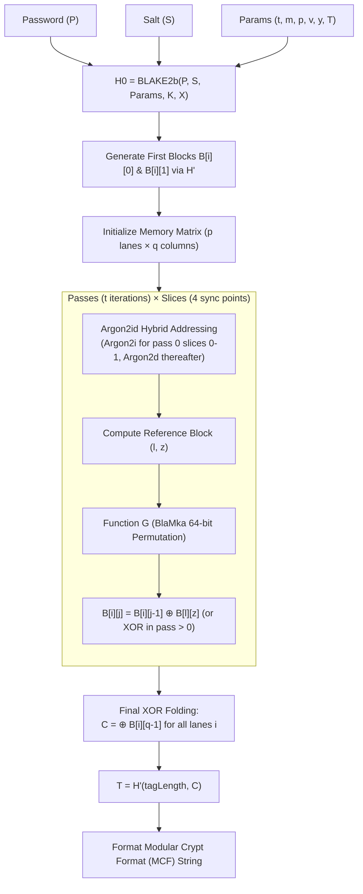

# HashForge 🔨

> **Independent, pure-JavaScript implementation of the Argon2id password-hashing algorithm (RFC 9106).**

[](https://opensource.org/licenses/Apache-2.0)
[](https://nodejs.org/)
[](https://vitest.dev/)

---

## 1. Introduction

**HashForge** is an independent, zero-dependency, pure-JavaScript implementation of **Argon2id**, the modern standard for memory-hard password hashing specified in [RFC 9106](https://www.rfc-editor.org/rfc/rfc9106.html).

Unlike bindings or wrappers around compiled C/C++ or WebAssembly binaries, HashForge is built natively in modern JavaScript (ES2022+) using typed arrays (`Uint8Array`, `BigInt64Array`), deterministic 64-bit word operations, and Node.js cryptographic primitives. It provides transparent, hackable, and audit-friendly password hashing for Node.js systems.

> [!CAUTION]
> **Cryptographic Notice**: This library is undergoing active staged development according to RFC 9106. Until it has undergone comprehensive third-party independent cryptographic auditing, it should be considered experimental in production environments.

---

## 2. Core Objective & API Design

HashForge targets an ergonomic, safe, and interoperable developer interface:

```javascript
import { hash, verify, needsRehash } from 'hashforge';

// Hash a password with RFC 9106 recommended defaults
const hashedPassword = await hash('correct-horse-battery-staple');
console.log(hashedPassword);
// => $argon2id$v=19$m=65536,t=3,p=4$c29tZXNhbHQ...$ZGF0YXRhZw...

// Verify a candidate password against the encoded hash
const isValid = await verify(hashedPassword, 'correct-horse-battery-staple');
console.log(isValid); // => true

// Check if an existing hash requires migration to updated parameters
const requiresUpgrade = needsRehash(hashedPassword, { memoryCost: 131072 });
console.log(requiresUpgrade); // => true
```

---

## 3. Architecture & Project Layout

HashForge adopts a modular, unbundled architecture where each layer of the Argon2id cryptographic pipeline is isolated into dedicated modules with strictly defined responsibilities:

```
hashforge/
├── src/
│   ├── index.js                  # Public package entry point
│   │
│   ├── api/                      # Public consumer-facing interfaces
│   │   ├── hash.js               # High-level password hashing API
│   │   ├── verify.js             # Constant-time password verification API
│   │   └── needsRehash.js        # Parameter inspection & rehash validation
│   │
│   ├── core/                     # Argon2id state machine & mathematical pipeline
│   │   ├── argon2.js             # Main execution orchestrator
│   │   ├── initialization.js     # Parameter concatenation, H0, & first blocks
│   │   ├── memory.js             # 1024-byte block representation & 2D matrix
│   │   ├── compression.js        # BlaMka arithmetic & 1024-byte compression function G
│   │   ├── indexing.js           # Argon2id reference block selection & addressing
│   │   └── finalization.js       # Lane XOR folding & final tag extraction
│   │
│   ├── crypto/                   # Low-level cryptographic primitives
│   │   ├── blake2b.js            # Pure-JS RFC 7693 BLAKE2b hash engine
│   │   ├── variableHash.js       # Variable-length BLAKE2b extension H' (RFC 9106 §3.2)
│   │   └── random.js             # Cryptographically secure salt generation
│   │
│   ├── utils/                    # Helper routines and defensive boundaries
│   │   ├── encoding.js           # Modular Crypt Format (MCF) & unpadded Base64
│   │   ├── validation.js         # Input sanitization & RFC parameter constraints
│   │   └── constantTime.js       # Timing-attack resistant buffer comparison
│   │
│   └── constants/                # Protocol parameters, bounds, and defaults
│       └── index.js
│
├── tests/                        # Staged unit and differential test suites
│   ├── foundation.test.js        # Architectural bounds and utility verification
│   ├── blake2b.test.js           # RFC 7693 BLAKE2b test vectors
│   ├── variableHash.test.js      # RFC 9106 Section 3.2 H' test vectors
│   ├── initialization.test.js    # H0 and block 0/1 initialization tests
│   ├── compression.test.js       # Function G & BlaMka permutation tests
│   ├── argon2.test.js            # RFC 9106 Argon2id test vectors
│   ├── verification.test.js      # High-level API & MCF roundtrip tests
│   └── vectors/                  # Static test vector data files
│
├── benchmarks/
│   └── benchmark.js              # Throughput and memory allocation profiling
│
├── examples/
│   └── express-auth.js           # Realistic authentication integration
│
├── LICENSE                       # Apache License 2.0
├── package.json                  # Node.js ESM configuration
└── README.md
```

---

## 4. How Argon2id Works (RFC 9106 Pipeline)

Argon2 is a memory-hard password-hashing function designed to withstand brute-force attacks powered by ASICs, GPUs, and custom FPGAs. It was selected as the winner of the Password Hashing Competition (PHC) in July 2015.



### The 5 Mathematical Stages

1. **Initial Hash ($H_0$)**:
   Parameters (lane count $p$, tag length $T$, memory size $m$, iterations $t$, version $v$, algorithm type $y$), along with lengths and bytes of the password ($P$), salt ($S$), secret key ($K$), and associated data ($X$) are concatenated into a parameter stream and digested using a single 64-byte BLAKE2b operation.

2. **Block Matrix Initialization**:
   The memory grid consists of $p$ lanes and $q = \lfloor m / (4p) \rfloor \times 4$ columns of 1024-byte blocks. For each lane $i \in [0, p-1]$:
   - $B[i][0] = H'(1024, H_0 \,\|\, 0 \,\|\, i)$
   - $B[i][1] = H'(1024, H_0 \,\|\, 1 \,\|\, i)$
   where $H'$ is the variable-length BLAKE2b extension.

3. **Hybrid Addressing (Argon2id)**:
   - **Data-Independent (Argon2i mode)**: Applied during the first half of pass 0 (slices 0 and 1). Addresses are generated deterministically using pseudo-random blocks produced by function $G$, eliminating memory cache timing side-channels.
   - **Data-Dependent (Argon2d mode)**: Applied during the remaining slices of pass 0 and all subsequent passes. Addresses are calculated directly from the contents of the previous memory block, providing maximum resistance against GPU/ASIC time-memory trade-off (TMTO) attacks.

4. **Block Permutation Function ($G$) and BlaMka**:
   Each 1024-byte block is transformed through eight 128-byte sub-matrices using the BlaMka round function. BlaMka modifies the BLAKE2b round function by augmenting 64-bit integer addition with a non-linear 64-bit multiplication:
   $$\text{BlaMka}(a, b) = a + b + 2 \times \text{low32}(a) \times \text{low32}(b) \pmod{2^{64}}$$

5. **Finalization ($H'$)**:
   After $t$ passes, the final blocks of all lanes $B[i][q-1]$ are XORed together to produce block $C$. The requested tag $T$ is derived as $T = H'(\tau, C)$ and encoded alongside parameters into standard MCF:
   `$argon2id$v=19$m=65536,t=3,p=4$<salt>$<hash>`

---

## 5. Security Requirements & Threat Model

HashForge enforces rigorous defensive security boundaries:

- **Timing Attack Mitigation**: Verifications utilize constant-time comparisons with dummy operations on unequal lengths to prevent timing discrepancies.
- **Strict Parameter Bounds**: Validates inputs against RFC 9106 boundaries and enforces memory caps (default limit 2 GiB) to prevent memory-exhaustion denial-of-service (DoS) attacks.
- **Cryptographic Randomness**: Salts are generated exclusively through `node:crypto.randomBytes`, rejecting pseudo-random sources like `Math.random()`.
- **Zero In-Memory Plaintext Retention**: Callers are encouraged to pass buffers that can be zeroed post-computation.

---

## 6. Implementation Roadmap

| Phase | Milestone | Status |
| :--- | :--- | :--- |
| **Phase 1** | Repository Setup, Architecture & Module Stubs | **Complete** |
| **Phase 2** | RFC 7693 BLAKE2b 64-bit Compression Engine | **Complete** |
| **Phase 3** | RFC 9106 §3.2 Variable-Length Hashing ($H'$) | **Complete** |
| **Phase 4** | Memory Block Matrix & $H_0$ Initialization | **Complete** |
| **Phase 5** | Compression Function $G$ & BlaMka Arithmetic | **Complete** |
| **Phase 6** | Argon2id Hybrid Addressing & Memory Passes | **Complete** |
| **Phase 7** | Final Block XOR & End-to-End Core Pipeline | Up Next |
| **Phase 8** | High-Level Public API (`hash`, `verify`, `needsRehash`) | Scheduled |
| **Phase 9** | RFC 9106 Official Test Vectors & Differential Testing | Scheduled |
| **Phase 10** | Performance Profiling & 64-bit Arithmetic Optimizations | Scheduled |
| **Phase 11** | Documentation, Packaging & Distribution Preparation | Scheduled |

---

## 7. Development & Testing

Run the test suite using Vitest:

```bash
# Run all unit tests once
npm test

# Run tests in continuous watch mode
npm run test:watch
```

---

## 8. License

Apache License 2.0. See [LICENSE](LICENSE) for details.

