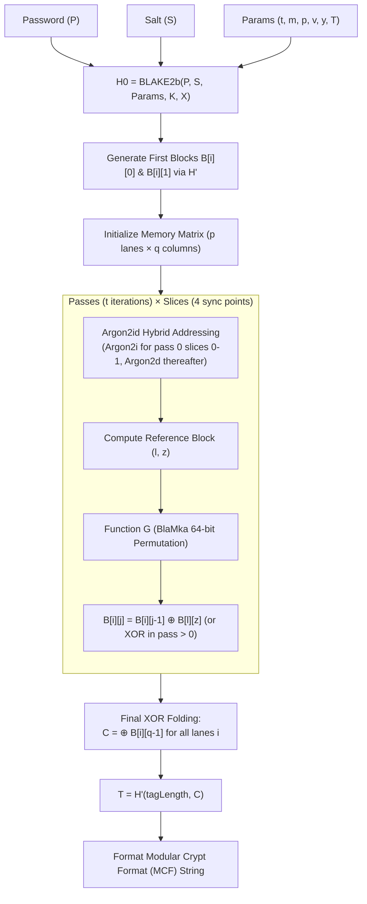

# HashForge 🔨

> **Independent, zero-dependency, pure-JavaScript implementation of the Argon2id password-hashing algorithm (RFC 9106).**

[](https://opensource.org/licenses/Apache-2.0)
[](https://nodejs.org/)
[](https://vitest.dev/)
[](https://www.typescriptlang.org/)

---

## 1. Introduction

**HashForge** is an independent, zero-dependency, pure-JavaScript implementation of **Argon2id**, the modern standard for memory-hard password hashing specified in [RFC 9106](https://www.rfc-editor.org/rfc/rfc9106.html).

Unlike bindings or wrappers around compiled C/C++ or WebAssembly binaries, HashForge is built natively in modern JavaScript (ES2022+) using typed arrays (`Uint8Array`, `BigUint64Array`), deterministic 64-bit word operations, and Node.js cryptographic primitives. It provides transparent, hackable, and audit-friendly password hashing for Node.js backends, serverless environments, and edge runtimes.

---

## 2. Quickstart

### Installation

```bash
npm install hashforge
```

### Basic Usage

```javascript
import { hash, verify, needsRehash } from 'hashforge';

// 1. Hash a password with RFC 9106 recommended defaults
const passwordHash = await hash('correct-horse-battery-staple');
console.log(passwordHash);
// => $argon2id$v=19$m=65536,t=3,p=4$vUCxfPBxmNIfvD+gDTLRJA$2PqzyKRoiI9...

// 2. Verify a password in constant time
const isValid = await verify(passwordHash, 'correct-horse-battery-staple');
console.log(isValid); // => true

// 3. Inspect hash parameters against an upgraded policy
const requiresRehash = needsRehash(passwordHash, { memoryCost: 131072 });
console.log(requiresRehash); // => true
```

---

## 3. Recommended Parameter Profiles

Argon2id balances memory hardness ($m$), computation passes ($t$), and parallelism lanes ($p$) to resist GPU and ASIC cracking:

| Profile | Memory ($m$) | Time ($t$) | Lanes ($p$) | Use Case / Environment |
| :--- | :--- | :--- | :--- | :--- |
| **High Security (RFC 9106)** | 65536 KiB (64 MiB) | 3 | 4 | Dedicated auth servers with high memory |
| **OWASP Minimum** | 19456 KiB (~19 MiB) | 2 | 1 | Production microservices & standard containers |
| **Lightweight / Mobile** | 1024 KiB (1 MiB) | 1 | 1 | Memory-constrained or low-latency workloads |
| **Testing / CI** | 64 KiB | 1 | 1 | Unit tests & rapid local development |

---

## 4. API Reference

### `hash(password, [options])`

Hashes a plaintext password string or buffer into an interoperable Modular Crypt Format (MCF) string.

- `password` (`string | Uint8Array | Buffer`): The password to hash.
- `options` (`object`, optional):
  - `memoryCost` (`number`): Memory size in KiB $m$ (default: `65536`). Minimum: $8 \times p$. Maximum: 2 GiB.
  - `timeCost` (`number`): Number of iterations $t$ (default: `3`). Minimum: `1`.
  - `parallelism` (`number`): Degree of parallelism $p$ (default: `4`). Minimum: `1`.
  - `hashLength` (`number`): Tag length $\tau$ in bytes (default: `32`). Minimum: `4`.
  - `saltLength` (`number`): Auto-generated salt size in bytes (default: `16`). Minimum: `8`.
  - `salt` (`Uint8Array | Buffer`): Optional custom salt. If provided, `saltLength` is ignored.
  - `type` (`number`): Algorithm variant (default: `ARGON2_TYPES.ARGON2ID` / `2`).
  - `version` (`number`): Specification version (default: `ARGON2_VERSIONS.V13` / `0x13`).
  - `secret` (`string | Uint8Array | Buffer`): Optional cryptographic pepper key $K$.
  - `associatedData` (`string | Uint8Array | Buffer`): Optional associated data $X$.
  - `raw` (`boolean`): If `true`, returns raw tag `Uint8Array` instead of MCF string.
- **Returns**: `Promise<string | Uint8Array>`

### `verify(encodedHash, candidatePassword, [options])`

Verifies a candidate password against an encoded MCF hash in constant time to prevent side-channel timing attacks.

- `encodedHash` (`string`): The MCF hash string (e.g. `$argon2id$v=19$...`).
- `candidatePassword` (`string | Uint8Array | Buffer`): The password candidate to test.
- `options` (`object`, optional):
  - `secret` (`string | Uint8Array | Buffer`): Pepper key used when creating the hash.
  - `associatedData` (`string | Uint8Array | Buffer`): Associated data used when creating the hash.
- **Returns**: `Promise<boolean>`

### `needsRehash(encodedHash, [desiredOptions])`

Inspects the parameters embedded in an MCF string and determines if the hash should be regenerated to match current security standards.

- `encodedHash` (`string`): Encoded hash to inspect.
- `desiredOptions` (`object`, optional): Target `memoryCost`, `timeCost`, `parallelism`, `version`, or `type`.
- **Returns**: `boolean`

### `argon2Core(options)`

Direct, synchronous access to the low-level Argon2 core pipeline for custom protocols or key derivation (KDF) applications.

---

## 5. Performance Benchmarks

Measured on Node.js v24 (ARM64 V8 Engine, macOS):

| Benchmark Item | Configuration | Throughput / Time |
| :--- | :--- | :--- |
| **BlaMka 64-bit Non-Linear Mixing** | Unit operation | **23.2 Million ops/sec** |
| **Function G (1024-byte block)** | Single block | **23,694 blocks/sec** (23.1 MB/s) |
| **Ultra-Fast (Testing)** | $m=64\text{ KiB}, t=1, p=1$ | **4.0 ms** |
| **Lightweight (Mobile/IoT)** | $m=1024\text{ KiB}, t=1, p=1$ | **45.6 ms** |
| **Microservice Profile** | $m=4096\text{ KiB}, t=2, p=2$ | **358.7 ms** |
| **OWASP Recommended Minimum** | $m=19456\text{ KiB}, t=2, p=1$ | **1.69 seconds** |

To run benchmarks locally:
```bash
npm run benchmark
```

---

## 6. Architecture & RFC 9106 Pipeline



---

## 7. Implementation Roadmap

| Phase | Milestone | Status |
| :--- | :--- | :--- |
| **Phase 1** | Repository Setup, Architecture & Module Stubs | **Complete** |
| **Phase 2** | RFC 7693 BLAKE2b 64-bit Compression Engine | **Complete** |
| **Phase 3** | RFC 9106 §3.2 Variable-Length Hashing ($H'$) | **Complete** |
| **Phase 4** | Memory Block Matrix & $H_0$ Initialization | **Complete** |
| **Phase 5** | Compression Function $G$ & BlaMka Arithmetic | **Complete** |
| **Phase 6** | Argon2id Hybrid Addressing & Memory Passes | **Complete** |
| **Phase 7** | Final Block XOR & End-to-End Core Pipeline | **Complete** |
| **Phase 8** | High-Level Public API (`hash`, `verify`, `needsRehash`) | **Complete** |
| **Phase 9** | RFC 9106 Official Test Vectors & Differential Testing | **Complete** |
| **Phase 10** | Performance Profiling & 64-bit Arithmetic Optimizations | **Complete** |
| **Phase 11** | Documentation, Packaging & Distribution Preparation | **Complete** |

---

## 8. Development & Testing

HashForge maintains 100% test pass rate across 9 comprehensive test suites:

```bash
# Run all 117 unit and differential tests
npm test

# Run tests in continuous watch mode
npm run test:watch

# Execute benchmark profiling harness
npm run benchmark

# Run production authentication example
node examples/express-auth.js
```

---

## 9. License

Apache License 2.0. See [LICENSE](LICENSE) for details.
